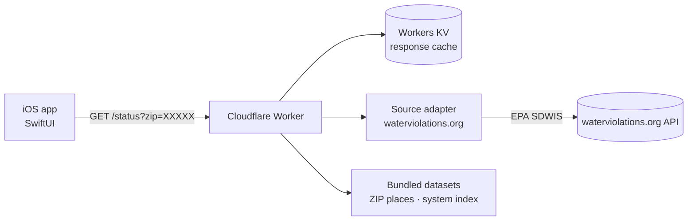

# Tapped

Tapped is an iOS application that reports, for a traveler's current location, what US drinking-water compliance records say about the local tap water, as a single red / yellow / green indicator with a short plain-language summary.

The app is a thin SwiftUI client. All data processing runs in a serverless API (Cloudflare Workers) that normalizes US EPA Safe Drinking Water Information System (SDWIS) records into one stable response contract.

> **Scope of the information.** Tapped summarizes regulatory compliance records. It is not a water test and does not certify that water is safe to drink. Results are labeled with the date through which the underlying EPA data runs.

## Features

- One-tap location lookup: approximate location is resolved to a ZIP code on the device. Only the five-digit ZIP code is sent to the API; coordinates never leave the device.
- Manual ZIP entry for denied location permission, trip planning, and geocoding failures.
- Place name display (neighborhood, city, state) resolved on the device.
- Transparent source attribution: each water system links to its public EPA-derived record.
- Explicit handling of permission-denied, location-unavailable, non-US, loading, and error states.
- Accessible status presentation: color is always paired with a symbol and a VoiceOver label; animations respect Reduce Motion.

## Architecture



| Component | Responsibility |
|---|---|
| `ios/` | SwiftUI client: location, on-device geocoding, presentation. |
| `backend/src/index.ts` | HTTP entry point, ZIP validation, caching, error mapping. |
| `backend/src/service.ts` | Selects the water systems that represent a ZIP and combines their scores. |
| `backend/src/scoring.ts` | All tunable scoring rules and selection thresholds. |
| `backend/src/copy.ts` | All user-facing wording. |
| `backend/src/adapters/` | Source-specific code, isolated behind the `SourceAdapter` interface. |
| `backend/scripts/` | Offline data builders for the bundled datasets. |

Design properties: the data source can be replaced without changing the app or the endpoint contract; scoring and wording are isolated in single files; successful responses are cached for three days because the source data changes quarterly.

Further detail: [docs/ARCHITECTURE.md](docs/ARCHITECTURE.md), [docs/METHODOLOGY.md](docs/METHODOLOGY.md).

## API

`GET /status?zip=21202`

```json
{
  "status": "green",
  "summary": "No health-based violations on record in the last 12 months of EPA data, and none open (EPA data as of December 2025).",
  "systems": [
    { "pwsid": "MD0300002", "name": "City of Baltimore", "populationServed": 1600000,
      "status": "green", "sourceUrl": "https://waterviolations.org/system/md0300002" }
  ],
  "dataAsOf": "December 2025",
  "multipleSystems": false,
  "source": "EPA SDWIS via waterviolations.org",
  "nearby": null,
  "note": null,
  "disclaimer": "Based on EPA compliance records, not a recent water test. This is not a guarantee that the water is safe to drink."
}
```

`status` is one of `green`, `yellow`, `red`, `unknown`. Invalid input returns `400`; upstream failures return `502`; errors are never cached.

## Scoring summary

| Status | Condition |
|---|---|
| Red | An open health-based violation involving bacteria, nitrate or nitrite, or a water-treatment failure (or an open violation of unknown type) |
| Yellow | An open long-term-exposure health-based violation; any health-based violation that began within 12 months of the data's end date; an open monitoring or reporting violation, or three or more within 12 months |
| Green | None of the above |
| Unknown | No water system found |

All recency windows are measured from the end date of the data, not from the current date, because the source data lags. Full rationale and known limitations: [docs/METHODOLOGY.md](docs/METHODOLOGY.md).

## Getting started

Requirements: Node.js 20+, Xcode 16+ (iOS 17+ deployment target).

```bash
# Backend
cd backend
npm install
npm test            # unit and integration tests
npm run typecheck
npm run dev         # local API at http://localhost:8787

# iOS
open ios/Tapped.xcodeproj   # Debug builds target http://localhost:8787
```

Deployment and data refresh procedures: [docs/DEPLOYMENT.md](docs/DEPLOYMENT.md). Pre-release requirements: [docs/RELEASE_CHECKLIST.md](docs/RELEASE_CHECKLIST.md).

## Repository layout

```
backend/    Cloudflare Worker (TypeScript), tests, offline data-build scripts
ios/        SwiftUI application (Xcode project)
docs/       Methodology, architecture, deployment, release checklist
```

## Development approach

Built by Colin Hatton with AI-assisted development tooling (Anthropic's Claude Code). Product requirements, data-source selection, scoring policy, and review decisions were directed and approved by the author; the implementation was validated against live EPA-derived data and an automated test suite.

## Limitations

- Systems are matched to a ZIP by registered address, not service area; suburbs served by a neighboring utility can resolve to a different system or to no result.
- A utility with no violations on record in the source data does not appear in the bundled system index.
- Compliance records are not a measure of present water quality.

See [docs/METHODOLOGY.md](docs/METHODOLOGY.md#known-limitations) for the complete list.

## Data sources and attribution

US EPA SDWIS (public domain) via [WaterViolations.org](https://waterviolations.org); GeoNames postal code data (CC BY 4.0). See [NOTICE.md](NOTICE.md).

## License

Source code: [MIT](LICENSE). Bundled third-party datasets retain their original licenses (see [NOTICE.md](NOTICE.md)).
